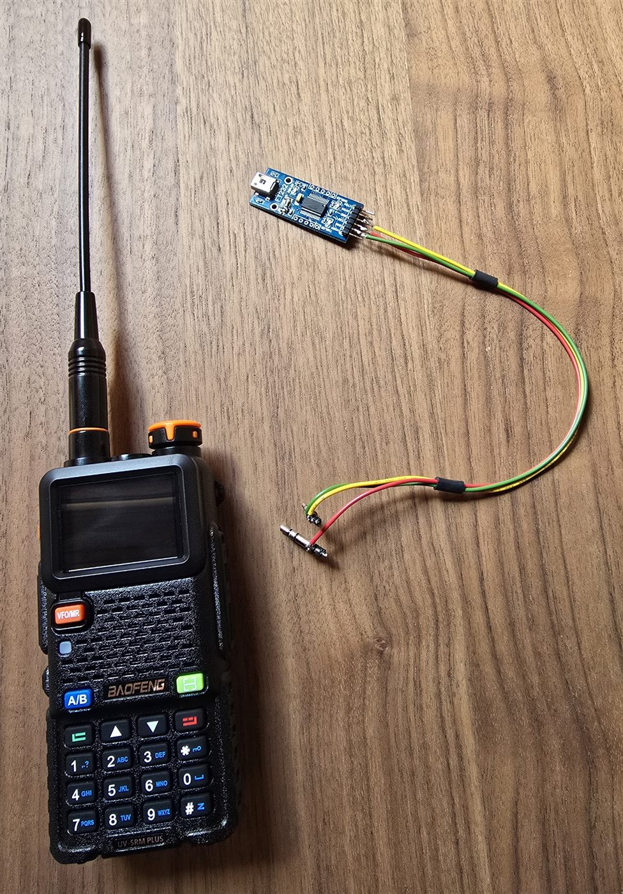

# UV-5RM Plus GPS — Fast Channel Editor

A small, **dependency-free** desktop editor for Baofeng `.xlc` codeplug files.
It lets you add, edit and bulk-generate channels and zones far more quickly than
the stock CPS grid, then writes a valid `.xlc` you can load back into the
manufacturer's software and flash to the radio.

Runs on Windows, macOS and Linux with nothing but a standard Python install —
the GUI uses `tkinter`, which ships with Python.

## Tested hardware



Developed and tested on a **Baofeng UV-5RM Plus (GPS)** using a **serial
programming cable** and the manufacturer's Windows CPS. As of today that CPS
appears to be the only software that reliably talks to this specific radio, and
its interface is clumsy for **entering and organizing zones and channels** (no
block paste, one-cell-at-a-time input). This tool exists to make that bulk input
fast, then hand a finished `.xlc` back to the CPS for writing to the radio.

> **Note on CHIRP:** [CHIRP](https://chirpmyradio.com/) lists the **Baofeng
> UV-5RM Plus (GPS)** as a supported model, but in testing here **serial
> communication with it never worked** on this radio, despite that listing. This is one first-hand report, not a general
> verdict on CHIRP — your mileage may vary — but if CHIRP fails to connect,
> the manufacturer's CPS (paired with this tool for the tedious parts) is the
> documented working path. That combination — CHIRP not working here, and the
> stock CPS too slow for bulk entry — is exactly the gap this project was
> built to fill.

> **Other Baofeng models:** only the **UV-5RM Plus (GPS)** has been
> reverse-engineered and tested. Nothing here is confirmed for the plain
> UV-5RM, UV-5RH, UV-5RH Pro, UV-5RM Pro, or any other variant — even if they
> use the same CPS, the same file size does **not** guarantee the same memory
> layout. If you own a different model and want to find out, send a small,
> predefined battery of `.xlc` files read from your radio through the CPS,
> each isolating one thing to check:
> 1. A base file, read straight from the radio, untouched.
> 2. The base plus one channel added in zone 1, slot 1, with a known
>    name/RX/TX/tone, **high power + wide band**.
> 3. The same, but **low power + narrow band + no tone**, to isolate the flag byte.
> 4. A channel added in the **last slot of a zone** (slot 64) and one in a
>    **second zone**, to confirm the zone table, slot indices and per-zone count.
> 5. A **zone renamed**, to locate the zone name field.
> 6. If exposed by the CPS, the **airband/band-limit toggle**, on and off.
>
> Diffing each file against the base isolates exactly which bytes move for
> each kind of change, which is what makes it possible to confirm (or find
> the differences in) the memory map before anything is written back. Once
> verified, the tool can be tried on that model too — as always, **back up
> before *and* after** writing to the radio.

> **Status:** community / hobby project. The `.xlc` layout was reverse-engineered
> from real codeplugs and is **not** official Baofeng documentation. It has been
> tested on a **single radio, by one person** — there may be unintended bugs on
> other units or firmware. Always keep a backup and sanity-check a few channels
> in the CPS before writing to a radio.

---

## Features

- Open an existing `.xlc` and edit it while **preserving every unrelated setting**
  (display mode, DTMF, APRS, etc.) — only channels, zones and the band limit are rewritten.
- Table view of all channels with add / edit / duplicate / delete.
- **Block generator**: create numbered series such as `LPD01…LPD64` with a fixed
  kHz step in one step.
- Rename all zones; up to 10 zones × 64 channels.
- Optional **aircraft-band unlock** (lowers the low band limit to 108 MHz for
  AM receive-only channels).
- **Automatic timestamped backup** of the previous file on every save.
- Clean separation between the file-format engine (`xlc_format.py`, no GUI,
  unit-tested) and the interface (`editor.py`).

---

## Requirements

- Python 3.9+ (Windows/macOS: use the official installer from
  [python.org](https://www.python.org/downloads/) and tick *“Add Python to PATH”*).
- No third-party packages. `tkinter` is part of the standard library on the
  official installers. On some Linux distros install it with, e.g.,
  `sudo apt install python3-tk`.

---

## Running

```bash
# from the repository root
python -m uv5rm_editor
```

On Windows you can also double-click `run.pyw` (see below) for a windowed launch
with no console.

---

## Recommended workflow

This tool only rewrites the **channel and zone** sections of the file. Everything
else the CPS stores — display mode, squelch, VOX, DTMF, APRS, GPS and all other
radio settings — is copied through untouched. To keep your radio's own settings,
start from a codeplug read **from your radio**:

1. In the Baofeng CPS, **read the current configuration from the radio** and save
   it as an `.xlc`. This is your base file (and your first backup — keep a copy).
2. Open that file in this editor. Add/edit channels, generate blocks, rename
   zones, then **Save**. You get a **new file with your new channels added while
   the old radio settings are preserved**.
3. Back in the CPS, **Open/Load** the new file and **Write** it to the radio.
4. Optionally read the radio again afterwards and save a **post-write backup**,
   so you have a snapshot of exactly what's on the radio now.

**Always keep a backup before *and* after.** The app also makes an automatic
timestamped `.bak` of the previous file every time you save, but your own CPS
read-backs are the real safety net.

## Usage (in the app)

1. **File → Open .xlc** and select the codeplug you read from the radio. It is
   used as a base so that all settings you are not editing stay intact.
2. Edit channels (double-click a row to edit), **Generate block**, or **Rename zones**.
3. Optionally enable **Tools → Allow aircraft band (108 MHz)**.
4. **File → Save** — a `.bak` copy of the previous file is created automatically.
5. In the Baofeng CPS: *Open/Load* the file, then *Write* it to the radio.

### Limits (same as the radio)

- Max **64 channels per zone**, max **10 zones** (saving is blocked on overflow).
- Channel names are limited to **10 characters**.
- Leave the TX field empty for a simplex channel.
- The tone field is the **TX CTCSS**. Separate RX tone and explicit AM mode are
  intentionally not written; on channels you don't touch they are preserved as-is.

---

## File format (short version)

131072-byte memory image. Channel records are 48 bytes at
`128 + ((zone-1)*64 + slot) * 48`; frequencies are little-endian BCD, tones are
big-endian BCD, and a per-channel flag byte holds power/bandwidth/tone bits.
Zone membership is tracked by an occupancy bitmap plus per-zone index tables.
See the module docstring in [`uv5rm_editor/xlc_format.py`](uv5rm_editor/xlc_format.py)
for the full map.

---

## Development

```bash
pip install pytest
pytest
```

The tests synthesize a minimal valid image in memory, so they need no sample
codeplug and no display.

### Building a standalone Windows .exe (optional)

```bash
pip install pyinstaller
pyinstaller --onefile --windowed --name "UV5RM-Editor" run.pyw
```

The executable appears in `dist/` and runs on machines without Python.

---

## Safety & legal

This tool only writes channel/zone data; it does not modify the radio firmware.
It was tested on a **single UV-5RM Plus (GPS) by one person**, so unintended
bugs on other units or firmware revisions are possible — **keep a backup before
and after writing**, and verify a few channels in the CPS first.

You are responsible for transmitting only on frequencies you are licensed to use.
Aircraft, marine, mountain-rescue and hut/lift link frequencies are **receive-only**
for most users. No warranty — see [LICENSE](LICENSE).

---

## Acknowledgements

Developed by **Gabriele Cervellin**, with AI assistance (Anthropic's Claude) used for the format
reverse-engineering, code, and tests. The reverse-engineering was driven and
validated against real codeplugs and an actual radio.

## License

[MIT](LICENSE) © Gabriele Cervellin

## Disclaimer & Trademarks

This is an independent, non-commercial hobby project. It is **not affiliated
with, endorsed by, or supported by Baofeng** or any of its subsidiaries or
partners.

"Baofeng", "UV-5RM Plus", "5RH Pro" and any other product names are trademarks
of their respective owners. They are used here **only descriptively**, to state
which hardware this tool interoperates with. No ownership of these marks is claimed.

The `.xlc` file structure used by this tool was determined independently, by
observing files produced by the user's own copy of the manufacturer's software,
for the sole purpose of **interoperability** (managing one's own channel data).
No manufacturer source code was accessed, copied, decompiled or redistributed.

Reverse-engineering context: the format was inferred from files saved by the
manufacturer's **"5RH PRO" CPS (version 1.21, 2025)**. The copy used shipped
with empty `License.txt` / `InfoBefore.txt` / `InfoAfter.txt` files, i.e. no
end-user licence agreement was presented or accepted. This work was carried out
for interoperability only.

The software is provided "as is", without warranty of any kind (see the LICENSE
file). You use it at your own risk. You are solely responsible for complying with
the license terms of any third-party software you use, and with all radio
regulations in your jurisdiction — including transmitting only on frequencies and
services you are authorized to use.
